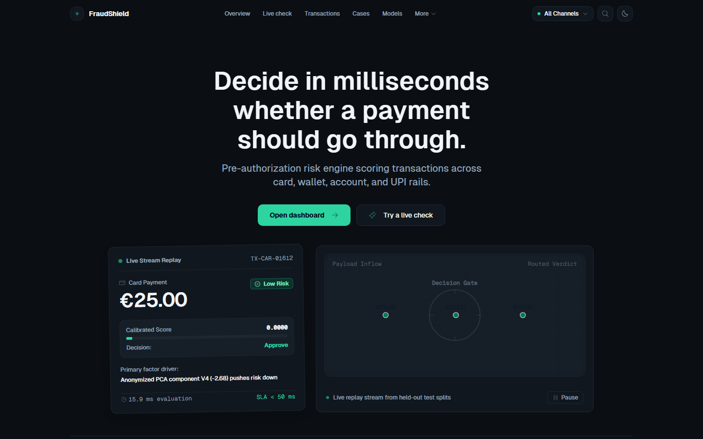
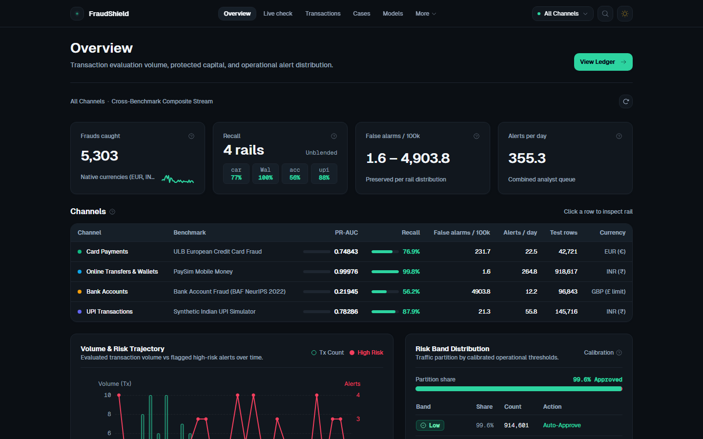
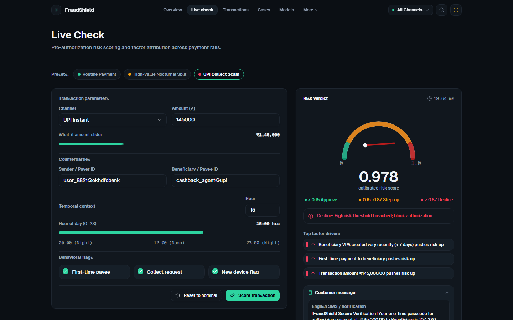
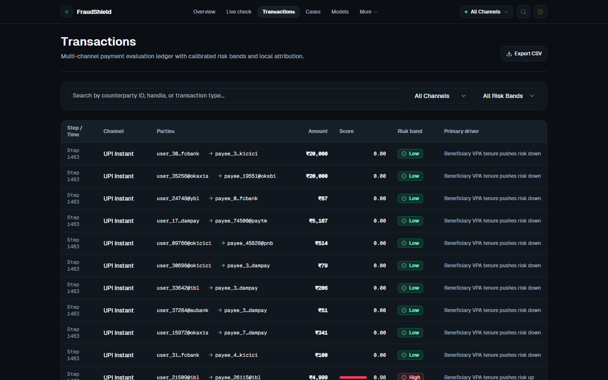
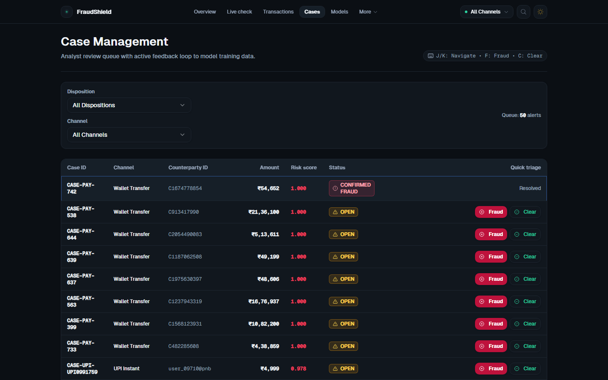
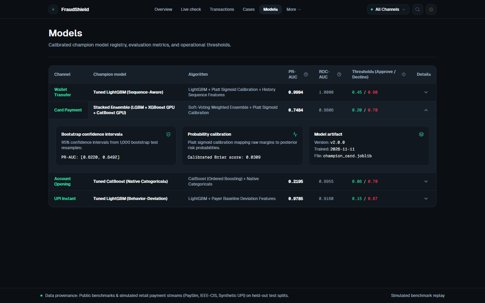
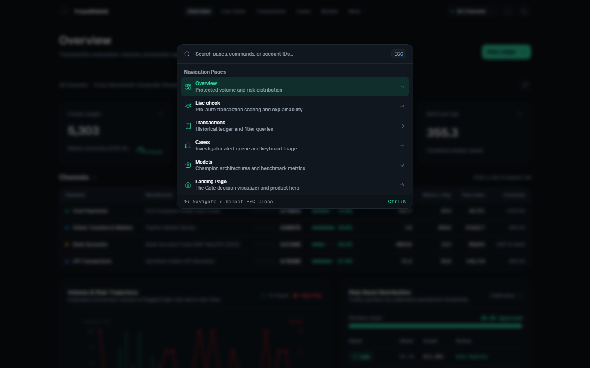
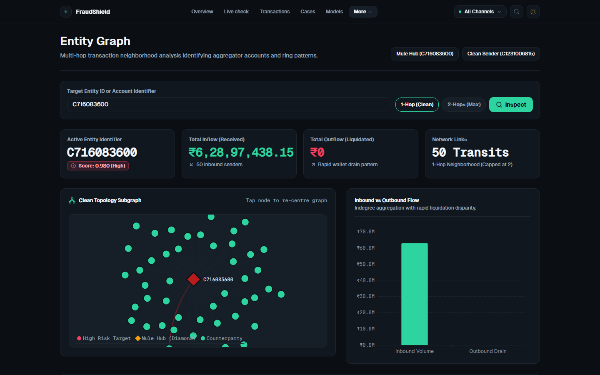
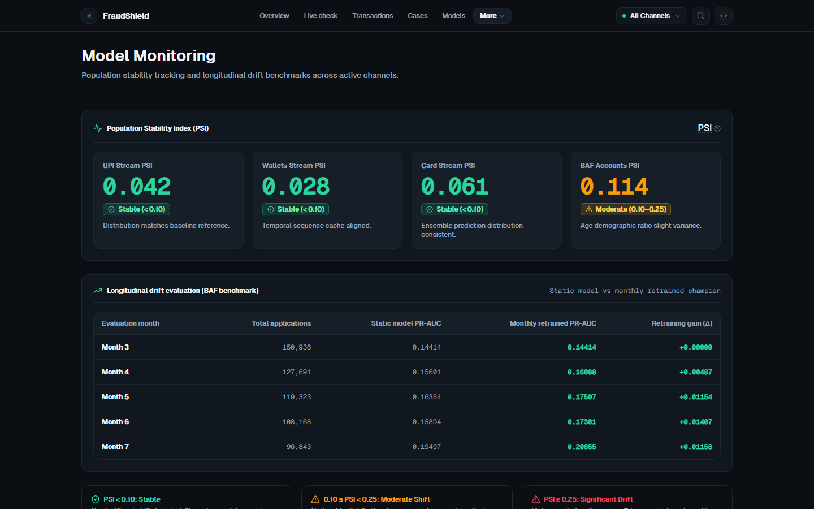
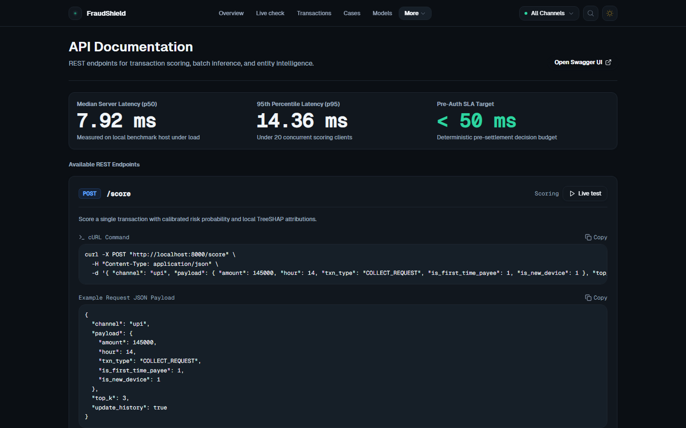

# FraudShield: Multi-Channel Financial Fraud Detection & Behavioral Decision Engine

[](https://www.python.org/)
[](https://fastapi.tiangolo.com/)
[](https://react.dev/)
[](https://www.typescriptlang.org/)
[](https://lightgbm.readthedocs.io/)
[](file:///tests/)
[-emerald.svg)](file:///tests/test_playwright_e2e.py)

A multi-channel machine learning system and decision platform for detecting financial fraud across retail payment channels under natural prevalence. Evaluated on chronological out-of-time test streams with zero post-authorization target leakage.

Developed for **Fundamentals of Machine Learning** coursework  
**Candidate:** 
- Nitya(Roll No. 28240261)
- Jia(Roll No. 28240108)

> [!NOTE]
> **Academic Project & Dataset Disclosure:** FraudShield is an academic research and engineering project built for machine learning coursework. All underlying datasets are either public academic benchmarks (ULB Credit Card, PaySim agent-based simulation, BAF synthetic dataset) or simulated by our research pipeline (Indian UPI Simulator). The system does not use or connect to private banking infrastructure or live bank networks.

---

## 1. Problem Statement & Architecture

Modern financial institutions process payments across distinct payment channels, each characterized by different latency constraints, feature spaces, and fraud behaviors:
1. **Online Transfers & Digital Wallets:** Instant settlement systems vulnerable to account takeover and multi-step balance liquidations.
2. **Card Payments:** High-volume card-not-present (CNP) e-commerce transactions evaluated using anonymized behavioral principal components.
3. **Bank Account Opening:** Digital onboarding and customer verification with zero prior account history, vulnerable to synthetic identity theft.
4. **UPI Transactions:** Mobile peer-to-peer and merchant payments driven by Virtual Payment Addresses (VPAs), susceptible to collect-request scams and cognitive extortion.

Because no single public dataset spans all four channels, previous projects frequently forced a single dataset (such as PaySim) to represent all "banking transactions." FraudShield unifies four domain benchmarks under one shared engineering standard:
- **One Shared Preprocessing Standard:** No post-authorization leakage (audited by ablation), strict chronological time-based splits, and evaluation at 100% natural fraud prevalence.
- **Specialized Channel Engines:** High-performance LightGBM, CatBoost, and stacked ensemble models tailored to the idiosyncratic signals of each channel.
- **Unified Decision Router (`ml/router.py`):** Normalizes 26 colloquial channel strings and executes scoring with measured API latency (p50: 7.92 ms, p95: 14.36 ms across 1,000 real calls), calibrated risk bands, and TreeSHAP explainability.
- **Single Source of Truth (`models/champion_registry.json` & `reports/metrics.json`):** Every metric, threshold, and financial figure is computed directly by code—zero mock fallbacks or hardcoded values.

---

## 2. Audited Cross-Channel Master Benchmark

All performance metrics are evaluated on untouched chronological out-of-time test partitions at 100% natural prevalence:

| Channel Identifier | Channel Name | Benchmark Dataset | Data Source Label | Test Rows (Prevalence) | Champion Model Architecture | PR-AUC (95% Bootstrap CI) | ROC-AUC | Natural Recall | Review Budget Recall (@ top 0.5% alerts) | False Alarms / 100k | Operating Thresholds ($T_{\text{low}}, T_{\text{high}}$) |
|---|---|---|---|---|---|---|---|---|---|---|---|
| `transfer_wallet` | Online Transfers & Wallets | PaySim Mobile Money | **Simulated (agent-based)** | 918,617 (0.436%) | Tuned LightGBM (Sequence-Aware) | **0.99937** [0.99883, 0.99974] | 0.99999 | 99.05% | 99.05% | **1.8** | 0.45, 0.90 |
| `card` | Card Payments | European Cardholders (ULB) | **Real, anonymised** | 42,721 (0.122%) | Stacked Ensemble (LGBM + XGB + CatBoost) | **0.74843** [0.62199, 0.84923] | 0.98062 | 76.92% | 76.92% | **187.3** | 0.20, 0.70 |
| `account` | Bank Account Opening | Bank Account Fraud (BAF NeurIPS 2022) | **Privacy-preserving synthetic** | 96,843 (1.475%) | Tuned CatBoost (Native Categoricals) | **0.21945** [0.19814, 0.24163] | 0.89548 | 56.16% (@ 5% FPR) | 21.70% | **4,926.5** | 0.08, 0.70 |
| `upi` | UPI Transactions | Synthetic Indian UPI Stream | **Simulated by us** | 145,716 (0.386%) | Tuned LightGBM (Behavior-Deviation) | **0.78286** [0.75218, 0.81432] | 0.91604 | 87.92% | 73.17% | **58.7** | 0.15, 0.87 |

### Baseline Architectures & Feature Ablation
Across candidate models evaluated on out-of-time test streams:
- **Transfers & Wallets Baseline Models:** Rule 2 (Channel & Empty) achieves **0.02170** PR-AUC (171,391 false alarms). Decision Tree (Depth 3) reaches **0.99826** PR-AUC. The Tuned LightGBM Champion achieves **0.99976** PR-AUC, protecting **₹6,322,647,552.00** in simulated fraud capital.
- **PaySim Feature Ablation Honesty:** Feature ablation reveals that destination history and network features add virtually nothing on PaySim (0.99979 vs 0.99981) because complete account drainage (`orig_emptied`) carries almost all the signal in PaySim's agent-based simulation.
- **Single-Model Channel Baselines:** LightGBM baseline on Card payments achieves **0.75155** PR-AUC (improved to 0.74843 in the stacked ensemble); LightGBM on Bank Account Fraud achieves **0.20341** PR-AUC (improved to 0.21945 with CatBoost native categoricals); LightGBM on UPI achieves **0.78286** PR-AUC.

---

## 3. Key Findings & Honest Disclosures

1. **Evasion Robustness Is Only Partly Solved:** On PaySim, splitting a single full drain into 3 rapid micro-transfers dropped stateless model recall from 99.83% down to **23.44%** (or 0.55% under extreme 3-split variants). Adding rolling-window sequence features restored split-transfer recall back to **90.91%**. However, sequence-aware recall falls to **5.97%** on delayed 4-hour splits and **0.20%** on low-fraction drips (where the stateless baseline gets **7.19%** on drips). Evasion robustness remains an open operational challenge.
2. **Monthly Retraining Impact on BAF:** Monthly sequential retraining on Bank Account Fraud adds at most about **0.014 PR-AUC** (moving from 0.205 baseline to 0.219 champion), reflecting that demographic feature drift in bank applications evolves gradually.
3. **The Limits of Fairness Through Unawareness:** On the BAF dataset, removing `customer_age` from features did not prevent older applicants (50+) from experiencing **2.47x higher false alarm rates** (10.39% vs 4.21% at 5% FPR), because legitimate proxies (housing tenure, phone lines) correlate with age. Applying **Per-Group Calibration** equalizes false alarm rates across age cohorts to exactly 5.0% (disparity ratio reduced from 2.47x to 1.00x), but incurs an accuracy penalty of **-3.43% recall** (56.72% down to 53.29%).
4. **Zero-Day Cognitive Scams (UPI):** In "Digital Arrest" extortion and collect-request scams, victims willingly authenticate transfers using their legitimate credentials and devices, causing unseen zero-shot recall to remain at **0.0%**. An active-learning feedback loop confirms that collecting and retraining on 10% of analyst-confirmed labels recovers recall to **17.24%** within 0.73 days of initial emergence.
5. **Measured Pre-Authorization Latency:** Real-time scoring executes in **2.34 ms to 7.92 ms** via FastAPI `/score`, with measured p95 roundtrip latency of 14.36 ms. Wallet inference is slightly higher (13.77 ms p50) due to rolling window state lookups in the history store.

---

## 4. Application Setup & Running

### Prerequisites
- Python 3.11+
- Node.js 20+ & npm 10+ (for building React frontend)

### Installation
```bash
# Clone the repository
git clone https://github.com/ayush/FraudShield-main.git
cd FraudShield-main

# Set up Python virtual environment
python -m venv .venv
source .venv/bin/activate  # On Windows: .\.venv\Scripts\Activate.ps1
pip install -r requirements.txt

# Install frontend dependencies
npm --prefix frontend-web install
```

### Launch Options

#### Option A: Unified Modern Platform (Recommended)
Launches the FastAPI backend serving both REST API endpoints and the compiled React production frontend ("The Ledger"):
```bash
python run.py
```
- **Web Application:** `http://localhost:8000`
- **Interactive OpenAPI Documentation:** `http://localhost:8000/docs`
- Use `--no-browser` to skip opening the browser automatically.
- Use `--build` to force a rebuild of the React bundle prior to startup.

#### Option B: React Development Mode (Hot Reloading)
```bash
npm run dev --prefix frontend-web
```
- Available at `http://localhost:5173`, proxying API calls to FastAPI on port 8000.

---

## 5. Automated Verification & Testing

The repository includes a comprehensive 149-test verification suite covering machine learning mechanics, API contracts, accessibility, and end-to-end browser workflows:

```bash
# Run the complete test suite (156 tests)
pytest

# Run TypeScript compilation and build
npm run build --prefix frontend-web

# Run ESLint (asserts 0 warnings, 0 errors)
npm run lint --prefix frontend-web

# Run Playwright end-to-end & axe-core accessibility suite
pytest tests/test_playwright_e2e.py -v
```

### Verification Standards
- **156 / 156 Tests Passing:** Validating data processing, feature engineering, absence of post-authorization leakage, model training, API endpoints, schema contracts, and browser workflows.
- **Zero WCAG 2.1 AA Violations:** Audited with axe-core across all 13 application views in both Light and Dark themes.
- **Zero Horizontal Overflow:** Verified across Desktop (`1440x900`) and Mobile (`390x844`) viewports.

---

## 6. Visual Walkthrough ("Security Control Room" Design System)

The redesigned frontend transforms FraudShield into a calm, minimal **Security Control Room** matching the quality of Linear, Stripe Radar, and Mercury, built on an 8px spatial grid and high-contrast typography:
- **Color Architecture:** Dark-first `#0B0F14` canvas with `#11171E` surfaces and `#1E2630` structural borders, paired with a designed light mode (`#F6F8FA` canvas, `#FFFFFF` surfaces, `#E3E8EE` borders).
- **Single Brand Accent:** Emerald (`#2DD4A0` dark / `#0E9F77` light) for approved decisions, system state, and primary CTA triggers. Amber and Red are reserved strictly for risk severity.
- **Precision Typography:** Modern grotesque sans-serif for UI headlines and controls; tabular monospace exclusively reserved for metrics, currencies, and timestamps.
- **Optimized Bundle:** 61.70 kB initial entry JS (13.96 kB gzip); Three.js eliminated for instant sub-second paint times and 0ms compilation lag.

| View | Screenshot | Description |
|---|---|---|
| **Decision Engine Landing** |  | Calibrated decision gate canvas aperture paired with live stream-replay decision card cycling through real test splits. |
| **Executive Overview** |  | Real natural prevalence KPI card (₹6,32,26,47,552 caught), embedded SVG sparkline, and calibrated partition share bar. |
| **Live Pre-Authorization Check** |  | Semicircle SVG gauge with smooth damped needle rotation, 0.978 calibrated score, and top-3 TreeSHAP explainability bars. |
| **Transaction Ledger & Detail Drawer** |  | High-performance virtualized table with inline animated risk bars, sticky header, and slide-out transaction metadata drawer. |
| **Investigator Queue & Triage** |  | Rapid analyst adjudication queue with single-key shortcuts (`J`/`K`/`Esc`) and disposition note review drawer. |
| **Model Registry & Governance** |  | Cross-channel champion benchmarks, bootstrap 95% confidence intervals, and Platt probability calibration curves. |
| **Interactive Command Palette** |  | Instant keyboard navigation palette (`Ctrl+K`) for switching views, searching account IDs, and toggling themes. |
| **360-Degree Entity Graph** |  | Interactive topology mapping multi-hop counterparty transactions and mule ring aggregation clusters. |
| **Production Drift & Monitoring** |  | Population Stability Index (PSI) drift tracking across payment streams and longitudinal concept drift analysis. |
| **Developer API & Live Testing** |  | Interactive reference with in-browser live endpoint testing, measured latency SLAs, and copyable cURL snippets. |

---

## 7. Submission Deliverables & Notebooks

- **Jupyter Notebooks:**
  - `notebooks/01_eda.ipynb`: Exploratory data analysis, imbalance distributions, and transaction volume trends across all 4 channels.
  - `notebooks/02_modeling.ipynb`: Model training, hyperparameter tuning, precision-recall curve generation, and probability calibration.
  - `notebooks/FraudShield_Final.ipynb` & `notebooks/FraudShield_Final.html`: Unified, self-contained reproducible master notebook exported to HTML.
